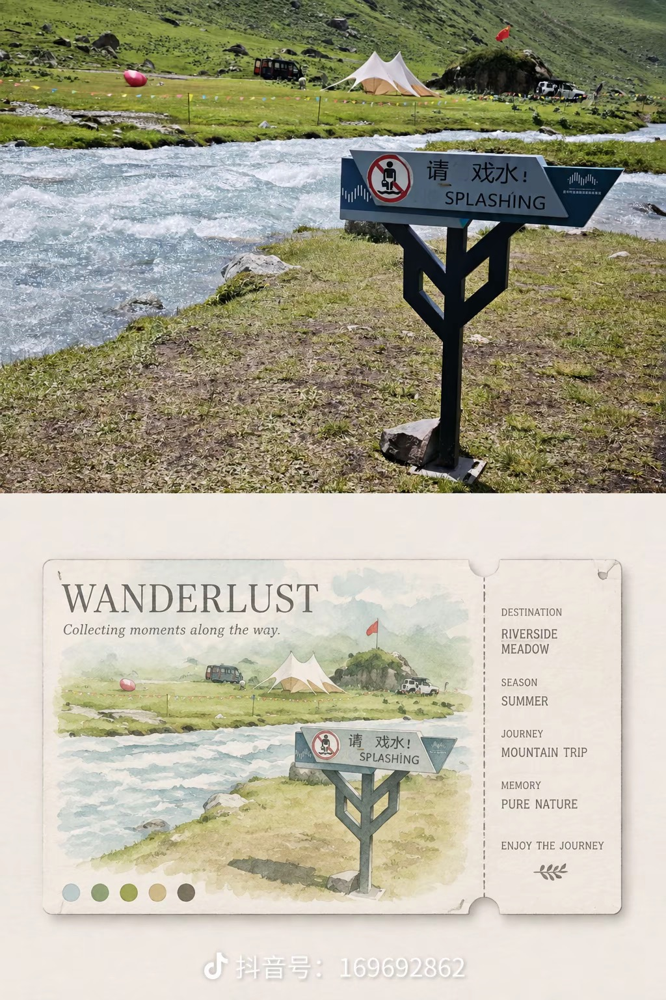
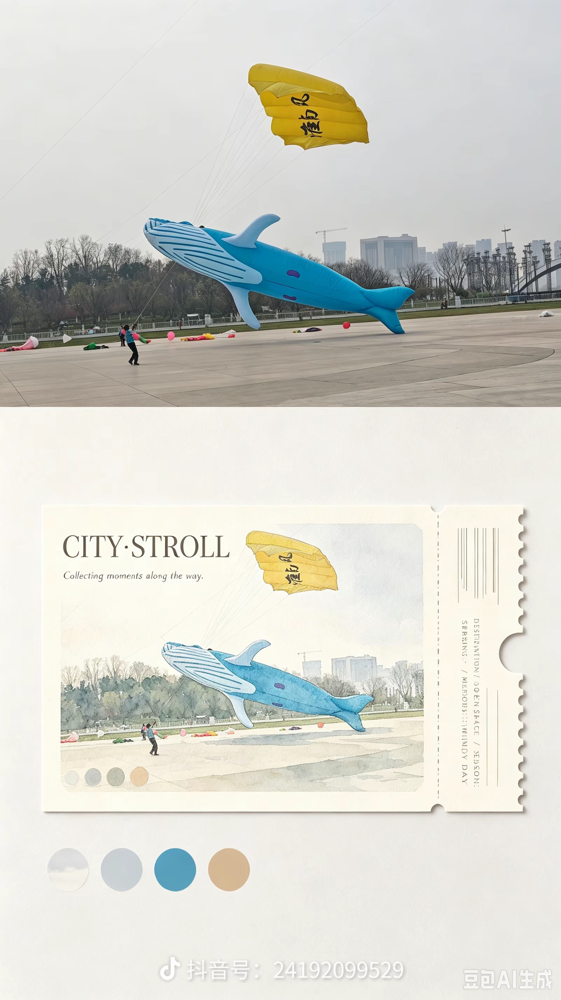
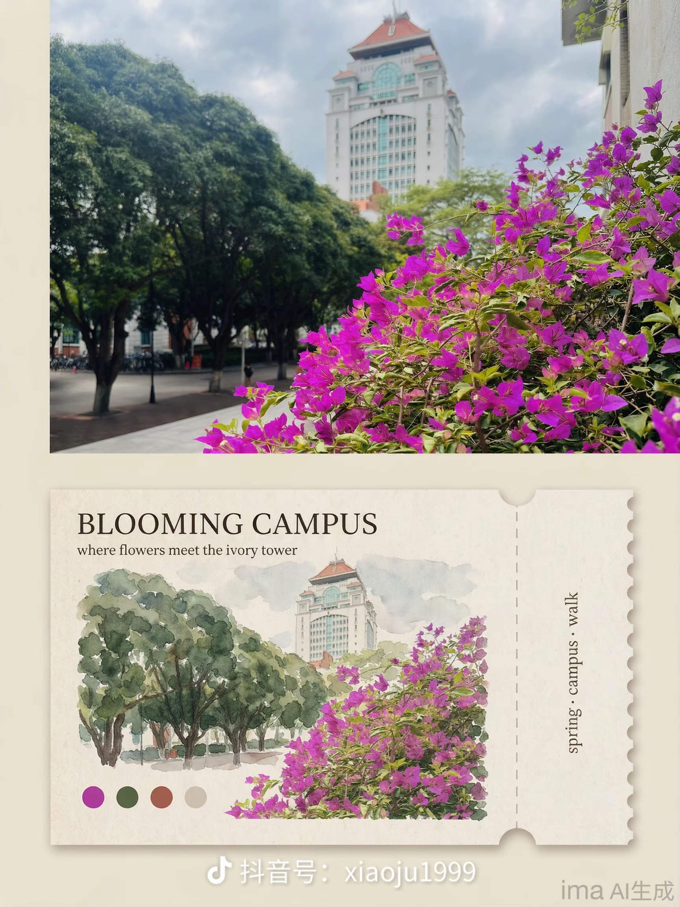
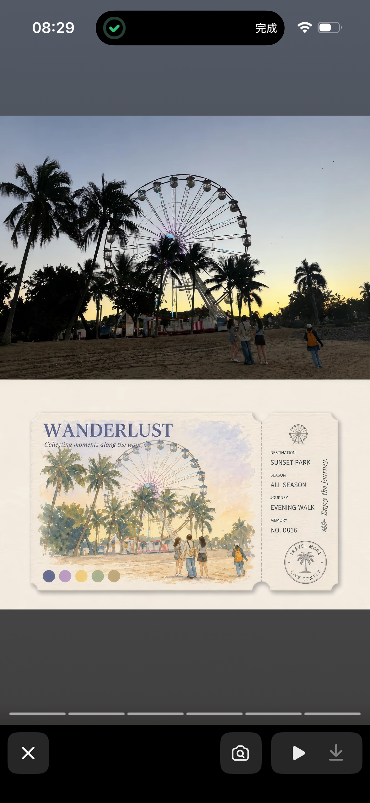

# 钢笔淡彩·漫游手账

```image-style-json
{
  "id": "penwash-travel-journal",
  "slug": "penwash-travel-journal",
  "name": "钢笔淡彩·漫游手账",
  "category": "image-to-image",
  "productKey": "general",
  "modelId": "seedream-50-flash",
  "description": "将照片转绘为原比例钢笔淡彩旅行插画，以自然晕染留白、四枚原图主色卡和手写英文标题构成完整手账画面。",
  "status": "draft",
  "version": "0.1.0",
  "sortOrder": 15,
  "promptTemplate": "严格保持参考照片的原始宽高比例、观察视角、地平线、主体身份、数量、轮廓、相对位置和主要空间关系，将照片转绘为钢笔淡彩旅行手账插画。用黑色极细钢笔轻轻勾勒必要轮廓，线条克制、自然，不使用粗重漫画描边；以低饱和、透明、通透柔和的水彩薄层表现景物，保留纸白与轻微水彩纸肌理。景物四周采用不规则、松散的水彩湿画法向外晕染并逐渐淡出，让插画与外围留白背景自然融合，不出现硬边框、卡片边缘、裁切线、折痕、垂直分割线、隔栏或照片与插画拼贴。外围底色根据原图光线和整体氛围自动适配：夜景使用协调的深色底调，日景或暖光场景使用柔和暖调，冷色风景使用清爽冷调；背景只作衬托，必须与景物边缘平滑过渡，不能形成独立色块或割裂留白。画面右下角整齐摆放恰好四个圆角方形纯色色卡，每个色卡只使用从参考原图提取的一种主色，四种颜色彼此有明显区分，不添加原图没有的装饰色。画面底部预留与整体画面融为一体的自然留白，在留白处添加一行简短英文手写标题及其下方一行简短英文手写句子；内容只概括画面可见主题或情绪，不编造地点、日期、人物或旅行事实。手写感随性、易读，像真实钢笔手写而非数字字体。整体简约、治愈、干净柔和，只保留必要的四枚色卡和两行文字，不添加其他装饰元素。场景重点：{{scene_description}}。",
  "negativePrompt": "不要改变原图比例、主要主体、主体数量、位置、视角或场景关系；不要裁切、重排、复制、替换或遗漏主要景物。禁止硬边框、明信片/票券外轮廓、卡片投影、打孔边、垂直分栏、隔断、切割线、折痕、照片拼贴或生硬的上下分界；留白必须与水彩景物自然晕染融合。禁止超过或少于四枚色卡，禁止渐变色卡、重复色卡、原图中不存在的装饰色和无关杂色；色卡必须为纯色圆角方形。禁止中文标题、乱码、长段文字、数字、地点/日期/路线等虚构信息、额外标签、邮戳、条码、贴纸、花边、图标、太阳/月亮等新增物体及水印；不要使用粗黑描边、浓重不透明水粉、油画笔触、过高饱和度或过度复古泛黄滤镜。",
  "rules": {
    "subjectPreservation": {
      "priority": "strict",
      "mustPreserve": ["原始画幅比例与观察视角", "主体身份与数量", "主要轮廓和相对位置", "地平线及核心空间关系"],
      "allowSimplification": ["远景细小纹理", "重复窗格和枝叶细节", "不影响识别的微小背景物"],
      "noInventedObjects": true
    },
    "rendering": {
      "medium": "黑色细钢笔线稿与透明淡彩水彩",
      "linework": "极细、克制、只勾勒必要结构",
      "wash": "低饱和、通透、柔和的多层水彩薄染",
      "edgeTreatment": "景物四周不规则晕染并自然淡出，边缘与外围底色融合",
      "paper": "轻微水彩纸肌理，避免强纹理和纸张边框"
    },
    "color": {
      "palette": "从原图主色取样，低饱和且保持自然冷暖关系",
      "backgroundAdaptation": {"night": "协调深调", "warmDaylight": "柔和暖调", "coolScenery": "清爽冷调"},
      "swatches": {"count": 4, "shape": "rounded-square", "fill": "solid", "source": "four distinct dominant colors sampled from the source photo"}
    },
    "layout": {
      "type": "source-ratio-seamless-bleed-travel-journal",
      "preserveSourceAspectRatio": true,
      "integratedBottomWhitespace": true,
      "noFrame": true,
      "noDivider": true,
      "swatchesPosition": "bottom-right"
    },
    "text": {
      "enabled": true,
      "language": "English",
      "title": "one short handwritten title at bottom whitespace",
      "caption": "one short handwritten sentence below title",
      "allowInventedFacts": false,
      "allowAdditionalText": false
    }
  },
  "controls": {
    "subjectPreservation": "strict",
    "compositionPreservation": "high",
    "styleIntensity": "medium",
    "linework": "fine-black-pen-minimal",
    "watercolorTransparency": "high",
    "saturation": "low-to-medium",
    "edgeBleed": "irregular-soft-fade",
    "backgroundTone": "source-mood-adaptive",
    "preserveAspectRatio": true,
    "swatchCount": 4,
    "swatchColorSource": "source-dominant-colors-only",
    "handwrittenEnglishText": "short-title-and-one-line-caption",
    "extraDecoration": "none"
  },
  "providerParameters": {},
  "maintainerNotes": "根据 2026-10-16 提供的提示词与原图/生成图对比样例独立整理，尚未导入后台进行新一轮模型验证。样例中的部分生成图使用了票券边框、穿孔侧栏和分栏，与本风格要求相冲突；样例仅用于观察水彩渲染、场景适配和颜色提取，不把其版式照搬。本风格与“旅行手账·清透淡彩”共享低饱和透明水彩媒介，但以极细黑钢笔线、无边界自然晕染、情绪自适应外围底色、恰好四枚原图色卡和底部英文手写标题为识别特征。先以草稿状态测试，评估英文文字准确度和四枚色卡颜色提取稳定性。"
}
```

## 原图与生成效果对照

以下素材为用户提供的对照图，原照片在上方，风格生成效果在下方。图中含有原平台截图/水印，仅用于本项目内部风格评估，不代表生成效果由当前小程序模型产生。

### 河边警示牌与草地



### 鲸鱼风筝与城市广场



### 校园花景



### 日落摩天轮


